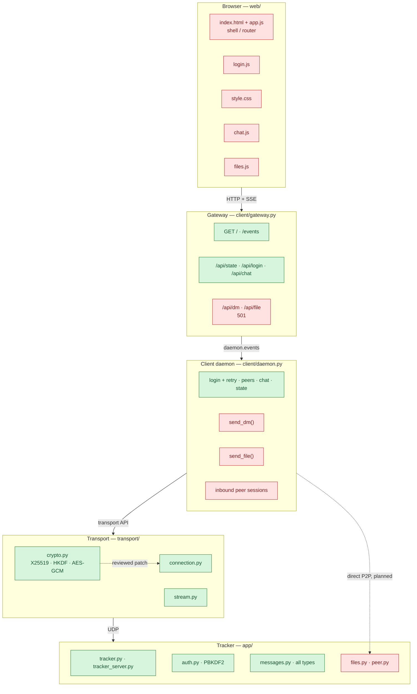

# Architecture & progress — P2P collaboration app

Snapshot: **Fri Nov 13 2026**. Source of truth: the code in this repo at
commit `7ecc873` plus the uncommitted working tree. This file is a status
view, not a contract; the contracts live in `team-handoff.md`,
`transport-api.md`, `auth-tracker-boundary.md`, and `gateway-api.md`.

Legend: **DONE** = implemented and exercised by a demo; **PARTIAL** = half of
the path exists; **TODO** = not started; **N/A** = documented non-goal.

## 1. Component map

```
┌───────────────────────────────────────────────────────────────────────────┐
│ BROWSER  (web/, no sockets, HTTP + SSE only)                              │
│  index.html + app.js  shell/router .......... PARTIAL (skeleton)          │
│  login.js ............................... PARTIAL (skeleton)              │
│  style.css ................................ PARTIAL (skeleton)            │
│  chat.js .................................. TODO   (Chat)                 │
│  dm.js .................................... DONE   (skeleton, DM owner)   │
│  files.js ................................. TODO   (Files)                │
└───────────────────────────────┬───────────────────────────────────────────┘
                                │  HTTP/1.1 + SSE, 127.0.0.1:8080
┌───────────────────────────────▼───────────────────────────────────────────┐
│ GATEWAY  client/gateway.py ................ DONE                          │
│  GET /  GET /events  GET /api/state  POST /api/login  POST /api/chat      │
│  POST /api/dm ............................. DONE                          │
│  POST /api/file ........................... TODO  (501 not_implemented)   │
└───────────────────────────────┬───────────────────────────────────────────┘
                                │  in-process: daemon.events (single consumer)
┌───────────────────────────────▼───────────────────────────────────────────┐
│ CLIENT DAEMON  client/daemon.py ........... PARTIAL                       │
│  login + retry, peers, chat, state(), stop  DONE                          │
│  send_dm() ................................ DONE                          │
│  send_file() .............................. TODO                          │
│  inbound peer sessions .................... DONE                          │
└───────────────┬───────────────────────────────────────┬───────────────────┘
                │ UDP, transport API                    │ direct P2P (planned)
┌───────────────▼───────────────────────┐   ┌───────────▼───────────────────┐
│ TRANSPORT  transport/                 │   │ PEER SESSIONS  app/peer.py    │
│  connection.py .................. DONE│   │  DM sessions ............. DONE│
│  stream.py ...................... DONE│   │  file helper ............. TODO│
│  stream.py ...................... DONE│   └───────────┬───────────────────┘
│  crypto.py ...................... DONE │               │
│  ENC flag + HELLO eph fields .... DONE (wired)                            │
│  congestion control / AIMD ...... N/A │                                   │
└───────────────┬───────────────────────┘                                   │
                │ UDP                                        direct UDP ◄───┘
┌───────────────▼───────────────────────────────────────────────────────────┐
│ TRACKER  app/tracker_server.py + app/tracker.py ......... DONE            │
│  roster, presence, gseq, history, LOGIN/CHAT_SEND/LOGOUT                  │
│  CONNECT_REQ / INTRO / RELAY ................. N/A (direct P2P instead)   │
├───────────────────────────────────────────────────────────────────────────┤
│ AUTH  app/auth.py (PBKDF2-SHA256, 600k) .................. DONE          │
│ MESSAGES  app/messages.py (all 20 types validated) ....... DONE          │
│ FILES  app/files.py (chunk/sha256/temp+rename) ........... TODO          │
│ STORAGE  data/accounts.json (untracked) .................. DECISION NEEDED│
└───────────────────────────────────────────────────────────────────────────┘
```

## 2. Detail flow (Mermaid)



## 3. Status matrix

| # | Area | Owner | Files | Status | Evidence |
|---|---|---|---|---|---|
| 1 | Packet / net / constants | Lương | `common/` | DONE | demos, stress scripts |
| 2 | Transport connection + streams | Lương | `transport/connection.py`, `stream.py` | DONE | `stream_udp_demo.py`, `multistream_demo.py`, 20% loss test |
| 3 | Messages schema | Lương | `app/messages.py` | DONE | 20 message types incl. all `FILE_*` |
| 4 | Tracker state + daemon | Lương | `app/tracker.py`, `tracker_server.py` | DONE | `discovery_demo.py` |
| 5 | Auth | Auth | `app/auth.py`, `app/admin.py` | DONE | PBKDF2 600k, `data/accounts.json` |
| 6 | Client daemon (login/chat/state) | Lương | `client/daemon.py` | PARTIAL | chat path works; no DM/files |
| 7 | Gateway HTTP + SSE | Lương | `client/gateway.py` | DONE | `gateway_demo.py` |
| 8 | Web shell + login | Auth | `web/index.html`, `app.js`, `style.css`, `login.js` | PARTIAL | working skeleton: login, presence, DM; Auth owns the final shell |
| 9 | Chat UI | Chat | `web/chat.js` | TODO | no file |
| 10 | Files: chunk/hash/verify | Files | `app/files.py` | TODO | no file |
| 11 | Peer sessions | Files | `app/peer.py` | DONE | direct DM sessions, bounded in-memory log; file dispatch still TODO |
| 12 | File UI | Files | `web/files.js` | TODO | no file |
| 13 | DM end to end | DM/Lương | daemon + gateway + `web/dm.js` | DONE | `POST /api/dm`, `state.dms`, SSE `dm`, working UI; no persistence/acks |
| 14 | Crypto | Crypto | `transport/crypto.py` | DONE | X25519 + HKDF + AES-GCM, wired in `connection.py`; 19 unit tests, loopback + demos pass |
| 15 | Tests | all | `tests/test_<area>.py` | PARTIAL | 32 tests: crypto, direct DM, gateway `/api/dm`; files/UI untested |
| 16 | Stress test, README, report | Lương | `README.md`, report | TODO | not started |

Rough count: **10 done, 2 partial, 4 not started** (of 16 tracked items).
Transport/tracker/messages/auth/chat-over-tracker/gateway/crypto/DM are
complete; chat UI, files, file UI and the report remain.

## 4. The three runtime paths

### Chat (green end to end except the UI)

```
login.js --POST /api/login--> gateway --> daemon.login --> LOGIN --> auth
  --> LOGIN_OK --> state
chat.js --POST /api/chat--> gateway --> CHAT_SEND --> tracker.gseq
  --> CHAT to all --> daemon event {kind:chat} --> SSE --> chat.js
```

Only the two browser ends are missing. The no-local-echo rule means the
sender must render the `chat` event, not dismiss the POST response.

### DM (working)

```
UI --POST /api/dm--> gateway --> daemon.send_dm --> direct P2P to roster addr
  --> DM on stream 0 --> peer daemon {kind:dm, direction} --> SSE --> UI
```

`state.dms` is the reconnect snapshot (100 per peer / 200 total, in memory).
The web skeleton renders outgoing events only (no local echo). No persistence,
delivery ack, offline queue, or multi-device sync.

### File transfer (mostly missing)

```
UI --POST /api/file (501)--> gateway --> daemon.send_file (missing)
  --> FILE_OFFER on stream 0 --> FILE_ACCEPT
  --> raw 64 KB chunks on a new stream --> FILE_END
  --> receiver sha256 compare --> FILE_DONE
  --> file_progress events --> SSE --> UI (missing)
```

What exists: `DM` sessions in `app/peer.py`, all `FILE_*` schemas, stream
fragmentation, a `file_progress` event shape. What is missing:
`app/files.py`, `FILE_*` dispatch in `app/peer.py`, `send_file`, gateway route,
and UI.

## 5. Blockers and critical path

1. **Web UI is the highest-value remaining work.** A working skeleton (login,
   presence, DM) is in place; the Auth owner should replace it with the final
   shell, and the Chat owner adds `chat.js`.
2. **Files are gated on `app/peer.py` dispatch.** DM sessions exist; files need
   `FILE_*` handlers, `send_file`, inbound stream handling, the gateway route
   and UI. `app/files.py` and `web/files.js` are still empty.
3. **Crypto is wired and tested.** `transport/crypto.py` is integrated in
   `connection.py`; install `cryptography` from `requirements.txt`. The
   remaining review item is the transport owner's sign-off on the wiring, plus
   the documented Level 1 MITM limitation. Crypto satisfies the security
   rubric point.
4. **No tracker change is needed for DM/files.** `tracker.handle` does not
   implement `CONNECT_REQ`, but the plan is direct P2P from roster addresses;
   `INTRO`/`RELAY` are documented non-goals.
5. **Tests are partial but growing.** 32 tests cover crypto, direct DM, and
   the gateway DM route. Files/UI still need tests, and the report needs the
   10–20 client stress run.

## 6. "Done" checklist for the remaining areas

- **UI**: login visible after 401, state/peers render, chat by `gseq` with no
  local echo, reconnect re-renders from the fresh `state` event.
- **Files**: chunk + sha256 + temp-file-rename, progress events, accept/reject,
  tamper/corrupt case produces `FILE_DONE {ok:false}` and no partial file.
- **DM**: one-to-one message over a direct connection, sender sees it only via
  the `dm` event.
- **Crypto**: round-trip, tampered ciphertext rejected, replayed `pkt_num`
  rejected, header as AAD, nonce from role byte + `pkt_num`.
